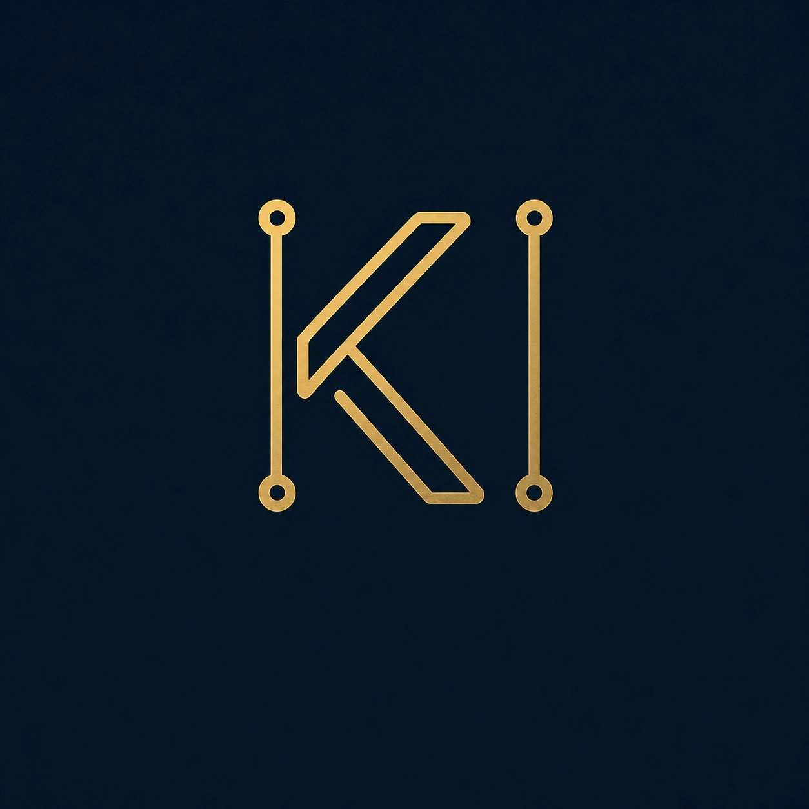

  

<h1 align="center">Khadija Ikram</h1>

  <strong>Cybersecurity Learner | Developer | Security Researcher in Progress</strong>

  
  
  

---

### `01` — About Me

I'm Khadija, a developer transitioning my focus toward
cybersecurity and practical security research.

- Exploring web application security and ethical hacking.
- Practicing on legal labs and Capture The Flag challenges.
- Building Python tools for security automation.
- Documenting what I learn through notes and write-ups.

> Learn deeply. Test ethically. Document everything.

### `02` — Current Focus

| Area | What I'm working on |
|---|---|
| Web Security | PortSwigger Academy, SQLi, XSS, authentication |
| Linux | Kali Linux, terminal fundamentals |
| Python | Security scripts and automation |
| CTFs | Challenge solving and technical write-ups |

### `03` — Featured Repositories

| Project | Description |
|---|---|
| [ThreatIQ](https://github.com/khadijakikram-3/ThreatIQ) | Security-focused Python project |
| [Python Security Tools](https://github.com/khadijakikram-3/python-security-tools) | Security scripts and automation |
| [CTF Write-ups](https://github.com/khadijakikram-3/ctf-writeups) | CTF solutions and learning notes |
| [PortSwigger Notes](https://github.com/khadijakikram-3/portswigger-notes) | Web security lab notes |
| [Cyber Journey](https://github.com/khadijakikram-3/cyber-journey) | Tracking my cybersecurity learning |

### `04` — Tech Stack

  
  
  
  
  

### `05` — My Principles

- Practice only on systems I own or have permission to test.
- Understand vulnerabilities instead of blindly copying payloads.
- Share reproducible findings and responsible security research.
- Keep learning, building, and improving.

---

  <em>Learning today. Securing tomorrow.</em>

