<!--
  KHADIJA IKRAM — profile README
  Every visual lives in /assets as a self-contained SVG (fonts are converted to outlines,
  so it renders identically on every device). Edit the repo links below if a name differs.
-->

  

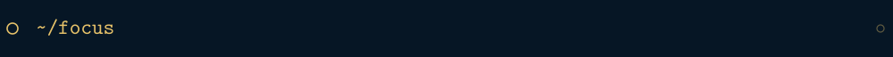
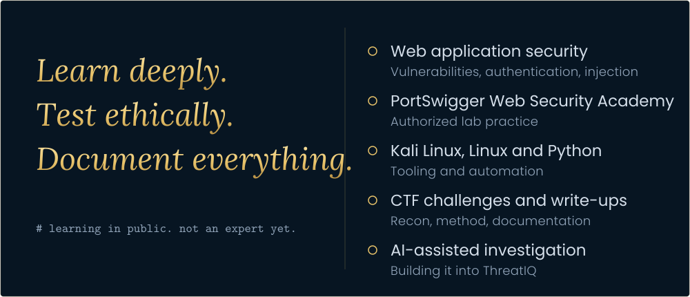

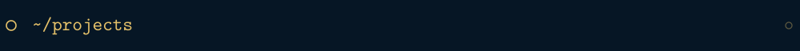
<a href="https://github.com/khadijaikram-3/ThreatIQ">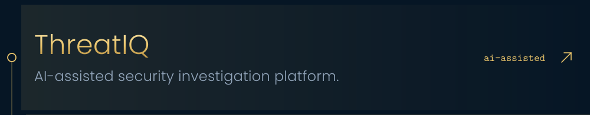</a>
<a href="https://github.com/khadijaikram-3/Revel">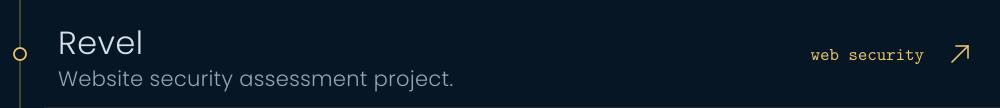</a>
<a href="https://github.com/khadijaikram-3/Website-Health-Security-Checker">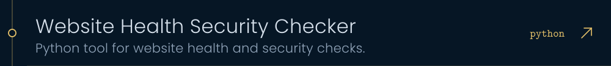</a>
<a href="https://github.com/khadijaikram-3/Python-Security-Tools">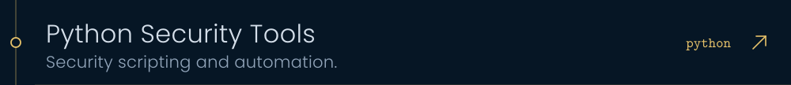</a>
<a href="https://github.com/khadijaikram-3/PortSwigger-Notes">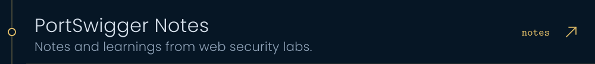</a>
<a href="https://github.com/khadijaikram-3/CTF-Writeups">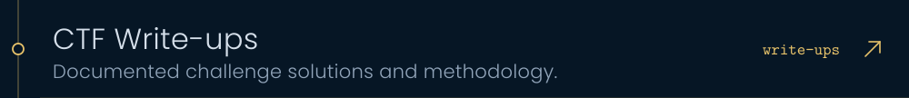</a>
<a href="https://github.com/khadijaikram-3/Cyber-Journey">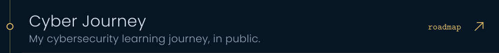</a>
<a href="https://github.com/khadijaikram-3/cyber-secure-website">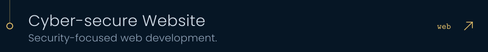</a>

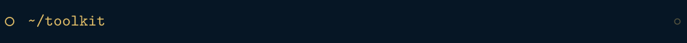
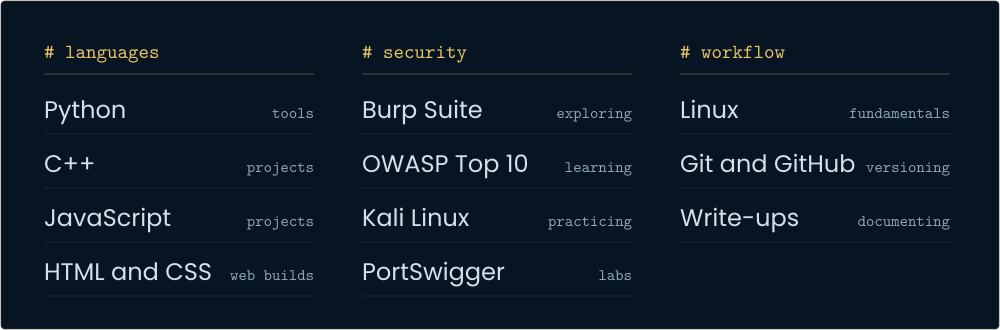

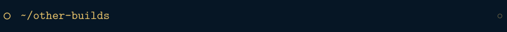
<a href="https://github.com/khadijaikram-3/Nexora">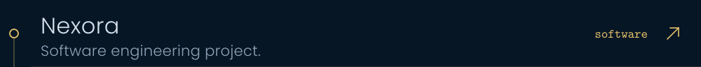</a>
<a href="https://github.com/khadijaikram-3/Chart-Visualizer-cpp">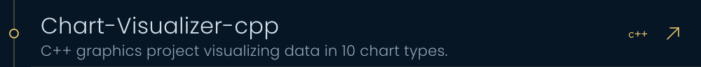</a>
<a href="https://github.com/khadijaikram-3/Khadija-Ikram-Portfolio">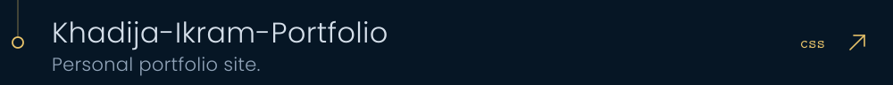</a>

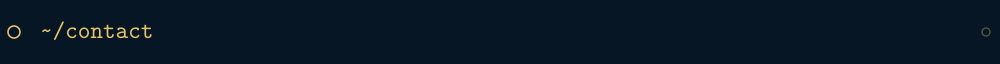

  <a href="https://www.linkedin.com/in/khadija-ikram-cs">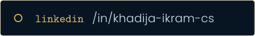</a>
  <a href="mailto:mkhadijaikram333@gmail.com">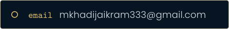</a>

  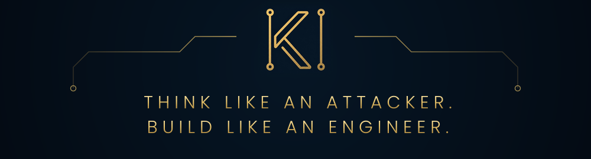

<!--
  OPTIONAL — live activity graph (third-party service; remove if it ever fails to load).
  Uncomment to add it between ~/other-builds and ~/contact.

  

-->
